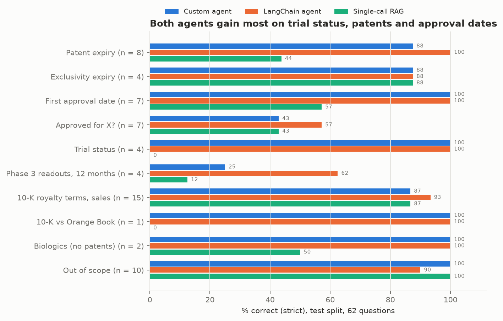
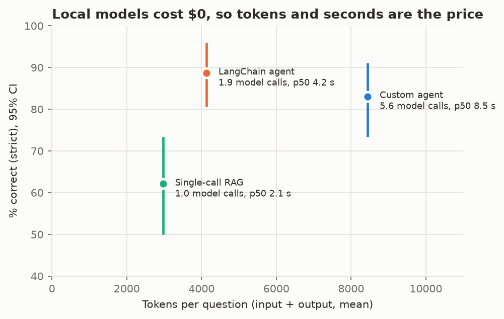
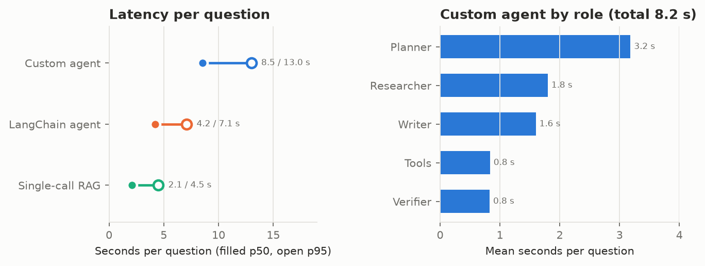

# diligence-agent: cited answers to drug diligence questions, with a pre-registered test

An investment team asks the same questions about every marketed drug: when its last Orange Book patent expires,
which Phase 3 trials read out in the next 12 months, what the 10-K says about the royalty, whether it's approved for
a given indication. This project answers them from public systems of record (FDA Orange Book, Drugs@FDA, FDA labels,
ClinicalTrials.gov, SEC EDGAR, PubMed), cites a source record for every claim, and replies **NOT IN SOURCES** when
the records don't answer. The drugs are the 32 products in Royalty Pharma's royalty portfolio, as listed in its
10-K for 2025 (`eval/drug_set.yaml`).

Three systems answer the same 62 held-out questions, all on `gemma4:e4b` through Ollama:

- **Custom agent** (`agent.py`): planner, researcher, verifier and writer roles in a hand-written loop.
- **LangChain agent** (`lc_agent.py`): LangChain's `create_agent` with the same seven tools.
- **Single-call RAG** (`baseline.py`): one retrieval, one model call, no tools. It's the number the agents have to
  beat.

On the test split, the custom agent beats single-call RAG by 21.0 points of strict correctness and the LangChain
agent by 26.6, both with paired 95% intervals above zero. The two agents don't differ measurably from each other.

## How it works

**Tools** (`tools/`, read-only, validated by pydantic, cached by a hash of tool, tool version and normalized
arguments):

| Tool | Source | Returns |
|---|---|---|
| `orange_book` | FDA Orange Book data files | applications, patents with expiry and use codes, exclusivities, and a latest-expiry summary record |
| `drugs_at_fda` | openFDA `/drug/drugsfda.json` | each NDA or BLA with sponsor, original approval date and efficacy supplements |
| `fda_label` | openFDA `/drug/label.json` | sections of the current prescribing information |
| `ctgov_search` | ClinicalTrials.gov API v2 | NCT id, phase, status and primary completion date, filtered by phase, status and date window |
| `edgar_filings` | SEC EDGAR submissions JSON | a company's recent filings of one form type |
| `pubmed_search` | PubMed E-utilities | top articles with abstracts |
| `doc_search` | the 10-K and the 32 labels, split by section | hybrid BM25 + `nomic-embed-text` search fused by reciprocal rank, from policy-rag's retrieval code |

Every HTTP call goes through one client (`http.py`): per-host rate limits under each source's published cap, up to 3
retries with full-jitter exponential backoff, `Retry-After` honored, a 60-second wall clock per tool call. Each tool
returns evidence records `{source, record id, url, text}`, and answers cite them as `[source:record_id]`.

**Custom agent** (`agent.py`):

1. **Planner** splits the question into steps and picks a tool for each.
2. **Researcher** calls tools with native tool calling, up to 3 turns per step. Invalid arguments get one repair
   try per tool per step. A repeated call with the same normalized arguments is refused, and 3 turns without new
   evidence end research.
3. **Writer** answers from the collected records only, sees the searches that produced them (a date window, a
   phase filter), and declines when they don't answer.
4. **Verifier** checks each claim twice: in code (every cited record was collected, and every date, year and
   percentage in the claim appears in it), then with the model against the cited text. Unsupported claims trigger
   one more research round and a redraft. Whatever still fails is cut, and an answer with nothing left becomes NOT
   IN SOURCES.

Budgets per request: 12 model calls, 60,000 tokens, $0 (enforced only for a priced model) and 600 seconds. Hitting
one stops the loop with the answer written so far.

**LangChain agent** (`lc_agent.py`): `create_agent` over `ChatOllama`, with the seven tools wrapped as
`StructuredTool`s around the same runner, `ModelCallLimitMiddleware` for the step budget, and middleware that refuses
repeated calls and traces every model and tool call.

**Single-call RAG** (`baseline.py`): one `doc_search`-style retrieval (hybrid, top 8) over an index that also holds
the Orange Book, Drugs@FDA and ClinicalTrials.gov records for the 32 products, flattened to text, so every gold
record is in the index. Then one model call.

**Tracing**: each question is one MLflow trace in `mlflow.db`, with a span per role, model call and tool call. Spans
carry latency, input and output tokens, dollars from the `pricing` table in `config.yaml`, model id, prompt hash and
cache hit. Each eval run logs its lineage: git commit, prompt hashes, eval-set hash, index build, Ollama version and
model digests.

## Run it

Requires [uv](https://docs.astral.sh/uv/) and [Ollama](https://ollama.com).

```bash
ollama pull gemma4:e4b
ollama pull nomic-embed-text
ollama pull gemma4:26b            # judge
uv sync
copy .env.example .env            # then set SEC_USER_AGENT to your name and email
uv run diligence-agent index      # download the 10-K and 32 labels, build the doc_search index
uv run diligence-agent index-baseline
uv run diligence-agent ask "When does the last-expiring Orange Book patent on Trikafta expire?"
uv run diligence-agent lc "Which Phase 3 trials of tarlatamab read out in the next 12 months?"
uv run diligence-agent eval --system agent --split dev
uv run diligence-agent analyze --split dev
uv run diligence-agent figures
uv run pytest
uv run mlflow ui --backend-store-uri sqlite:///mlflow.db
```

`--fake` serves recorded tool responses, so the tools, both agents and the tests run without a network or Ollama.
`uv sync --extra rerank` installs the optional cross-encoder reranker.

## Evaluation

The eval set, the graders and the pre-registered tests were fixed before the test split was scored. Prompt,
budget and grader changes before that were made on dev.

**93 questions** (`eval/questions.jsonl`), built by `diligence-agent build-eval` from the systems of record, so every
gold answer traces to a source record. 31 dev, 62 test, split stratified by category (seed 7). 28 are worded the way
an analyst would ask ("Any Imdelltra Phase 3 readouts coming in the next 12 months?").

| Category | Questions | Graded by |
|---|---|---|
| Last-expiring Orange Book patent | 12 | code: the gold date (half credit if it isn't the first date given) |
| Latest-expiring exclusivity | 6 | code: the gold date |
| First FDA approval date | 10 | code: the gold date |
| Approved for an indication? | 10 | code: yes or no in the first sentence |
| Trial status and primary completion | 6 | code: status and month |
| Phase 3 readouts in the next 12 months | 6 | code: F1 over NCT ids |
| 10-K royalty terms, receipts, sales | 23 | code (dollar amounts within 1%, years); judge on 8 wording questions |
| 10-K vs Orange Book on the same patent | 2 | code: both dates |
| Orange Book patents for a biologic | 3 | code: says none are listed, or declines |
| Out of scope (list prices, analyst targets, EU patents…) | 15 | code: declines |

**Grading rules** from policy-rag's `code_rules`, applied after every check: declines are detected in code (the exact
reply, or prose in the first sentence), and a decline on an answerable question scores 0 (`correct_strict`). The
judge's raw grade is kept beside it.

**Pre-registered tests** (`config.yaml`, `preregistered`), frozen at git tag `eval-test-v1` before the test split
was scored. The scorer refuses the test split unless the block is frozen and HEAD is a clean checkout of that tag,
and refuses to score a repeat twice:

| Test | Pass if |
|---|---|
| H1: the custom agent beats single-call RAG | paired bootstrap 95% CI of the difference in `correct_strict` above 0, and no more false declines |
| H2: the LangChain agent beats single-call RAG | same rule |
| H3: the two agents differ | the 95% CI excludes 0; otherwise "no difference shown" |
| H4: the agents decline out-of-scope questions | at least 9 of the 10 in test, for each agent |

The test split ran twice from the tag. Repeat 1 is primary, and repeat 2 measures run-to-run change.

## Results

Test split, 62 questions, repeat 1 (`reports/eval.json`). Intervals are 95% bootstrap CIs, 10,000 resamples.

**Pre-registered tests**

| Test | Result | Difference in `correct_strict` |
|---|---|---|
| H1: custom agent vs single-call RAG | **pass**; false declines 4 vs. 10 of 50 | +21.0 points [+9.7, +33.1] |
| H2: LangChain agent vs single-call RAG | **pass**; false declines 1 vs. 10 of 50 | +26.6 points [+14.5, +38.7] |
| H3: custom agent vs LangChain agent | **no difference shown** | −5.6 points [−13.7, +1.6] |
| H4: out-of-scope declines | **pass** after one deviation (below); custom agent 10 of 10, LangChain 9 of 10 | – |

As first scored (`reports/eval_as_preregistered.json`), H4 failed: LangChain declined 8 of 10. One of its two misses
was oos03, "What royalty rate does Royalty Pharma receive on Ozempic?", answered with "The search for the royalty
rate on Ozempic in Royalty Pharma's 10-K filings did not return any records." The decline detector had treated an
empty search as a finding. After the test run, I decided that reply is a decline and extended the detector
(`config.yaml`, `deviations`). That moves LangChain from 87.1% to 88.7%, H2 from +25.0 to +26.6 points, and H3 from
−4.0 [−12.1, +4.0] to −5.6 [−13.7, +1.6]. It also reclassifies three LangChain biologic answers as declines, whose
correctness doesn't change because declining is right on those questions.

**Per system**

| | Custom agent | LangChain agent | Single-call RAG |
|---|---|---|---|
| Correct (strict), all 62 | **83.1%** [73.4, 91.1] | **88.7%** [80.6, 96.0] | 62.1% [50.0, 73.4] |
| Analyst wording, 41 / plain wording, 21 | 86.6% / 76.2% | 92.7% / 81.0% | 64.6% / 57.1% |
| False declines, of 50 answerable | 4 | 1 | 10 |
| Out-of-scope declined, of 10 | 10 | 9 | 10 |
| Answers passing the citation check | 46 of 46 (61 of 61 claims) | 46 of 50 (71 of 77 claims) | 38 of 41 (65 of 68 claims) |
| Model calls per question (mean) | 5.6 | 1.9 | 1 |
| Tool-call validity | 100% | 100% | – |
| Budget stops / repeated calls refused / loop stops | 4 / 4 / 0 | 0 / 0 / 0 | – |
| Latency p50 / p95 | 8.5 s / 13.0 s | 4.2 s / 7.1 s | 2.1 s / 4.5 s |
| Tokens per question (mean) | 8,446 | 4,136 | 2,974 |
| Dollars | $0 | $0 | $0 |
| Repeat 2: answers changed / grades changed | 2 / 1 (82.3%) | 0 / 0 | 0 / 0 |

The citation check is the verifier's code check, run on every system's saved answers: a claim passes when it cites
only records the system collected and every date, year and percentage in it appears in those records or in the
question. Declines make no claims and are left out. The custom agent passes every claim because its verifier
already ran this check and cut what failed: 66 claims were verified, 60 passed, 6 were cut, and 6 questions took a
second research round. The check catches a wrong source or a made-up number. It doesn't catch a right number from
the wrong row: the agent's tk06 answer gave Trodelvy's royalty tiers for Imdelltra, cited the 10-K table holding
both rows, and passed.



| Category | Questions | Custom agent | LangChain agent | Single-call RAG |
|---|---|---|---|---|
| Patent expiry | 8 | 87.5% [62.5, 100.0] | 100.0% | 43.8% [12.5, 75.0] |
| Exclusivity expiry | 4 | 87.5% [62.5, 100.0] | 87.5% [62.5, 100.0] | 87.5% [62.5, 100.0] |
| First approval date | 7 | 100.0% | 100.0% | 57.1% [14.3, 85.7] |
| Approved for X? | 7 | 42.9% [14.3, 85.7] | 57.1% [14.3, 85.7] | 42.9% [14.3, 85.7] |
| Trial status | 4 | 100.0% | 100.0% | 0.0% |
| Phase 3 readouts, 12 months | 4 | 25.0% [0.0, 50.0] | 62.5% [25.0, 100.0] | 12.5% [0.0, 37.5] |
| 10-K royalty terms, sales | 15 | 86.7% [66.7, 100.0] | 93.3% [80.0, 100.0] | 86.7% [66.7, 100.0] |
| 10-K vs Orange Book | 1 | 100.0% | 100.0% | 0.0% |
| Biologics (no patents) | 2 | 100.0% | 100.0% | 50.0% [0.0, 100.0] |
| Out of scope | 10 | 100.0% | 90.0% [70.0, 100.0] | 100.0% |

Intervals are 95% bootstrap CIs from `reports/eval.json`. A score of 0% or 100% has no interval: every resample of
identical grades returns the same mean, so the bootstrap can't measure uncertainty there, and with 1 to 15
questions per category, a perfect score is weak evidence.

*What it shows:* single-call RAG loses most of its points on records that carry the answer in a field: trial status
(0 of 4, all declined), patent expiry (44%), first approval date (57%) and the 10-K vs Orange Book comparison. Its
index holds the gold record for every question, but on dev, hybrid rank fusion buried exact NCT ids that BM25
ranked first, and "last-expiring" needs a comparison across every patent record, more than 8 retrieved chunks hold. The
agents call `ctgov_search` and `orange_book`, which return those fields directly. On 10-K questions all three are
within one question of each other (87%, 93%, 87%), since `doc_search` and the baseline read the same chunks.

Both agents are weakest on two categories:

- **Phase 3 readouts in the next 12 months:** the custom agent scores 25% and LangChain 62%. The custom agent
  declined two of the four questions and hit the step budget on the other two with partial lists.
- **Indication questions whose answer is no:** the custom agent scores 0 on all 4 and LangChain on 3 (43% and 57%
  overall, with the 3 yes questions all correct). In 5 of those 12 answers, across the three systems, the answer says the indication isn't
  approved or listed, but in a second sentence or as "the label does not list X". The yes/no check reads only
  the first sentence, and the decline detector reads "does not list" as a decline. On dev, I labeled one such
  answer correct (Voranigo for glioblastoma). The pre-registered check scores these 0, and the numbers above use
  it.

*What it decides:* for questions whose answer is a field in a system of record, a tool call beats retrieval over
flattened text, even when the flattened text is in the index. The next changes, each to be tested on dev:

- raise the custom agent's step budget for multi-record questions such as readout windows, where it stopped early;
- ask the writer to open yes/no answers with "Yes" or "No";
- extend the yes/no check to the whole answer, with a fresh test split (this test split is spent).



*What it shows:* every model runs locally, so the dollar cost is $0 and the price is tokens and seconds. LangChain
gets the highest score at half the custom agent's tokens (4,136 vs. 8,446 per question) and 1.9 model calls
against 5.6. The custom agent's extra calls are the planner and verifier. The verifier cut 6 claims, and the agent
has the only perfect citation-check score. On correctness, the paired difference between the agents is −5.6 points
[−13.7, +1.6].

*What it decides:* on this question set, the planner and verifier don't buy correctness. Their measurable return
is citation hygiene: 0 unsupported claims, against 6 of 77 for LangChain. With a priced hosted model, the token
column becomes dollars, and that comparison decides whether the verifier stays.



*What it shows:* the custom agent takes 8.5 s at p50 and 13.0 s at p95. The planner is the largest share, 3.2 s of
8.2 s on average, followed by the researcher (1.8 s), the writer (1.6 s), tool calls (0.8 s) and the verifier
(0.8 s).

*What it decides:* the planner is the first role to cut. LangChain runs without one and scores no lower, so a test
on dev is to drop the planner and have the researcher pick tools from the question.

**Judge calibration** (`reports/judge_calibration.json`, 40 dev answers, all 12 judge-graded ones plus a sample
stratified by category)

| | Agreement with my labels | Cohen's kappa | Judge pass rate | My pass rate |
|---|---|---|---|---|
| Correctness | 87.5% (35 of 40) | 0.48 | 90.0% | 82.5% |
| Faithfulness | 95.0% (38 of 40) | not informative* | 95.0% | 100% |
| Judge vs. code checks, 81 code-graded dev answers | 87.7% | 0.55 | – | – |

\* I labeled all 40 answers faithful, so kappa has no variance to measure.

The judge (`gemma4:26b`) failed the pre-registered bar of kappa 0.6 on both. Four of its five correctness
disagreements were declines on answerable questions that it passed, the same leniency policy-rag found. On
faithfulness, it failed two wrong or partly wrong answers whose cited records say what the answer says. The pre-registered fallback
applied: my labels replace the judge on the 8 judge-graded questions (`correct_source: human` in the answer files),
and faithfulness is reported from the citation check above. The 40 dev labels started from model-drafted grades
with reasons, and I reviewed each one. I changed 1 of the 80 grades and noted my readings of the borderline rows in
the sheet. The 12 distinct judge-graded test answers I labeled without drafts. One label went from 1 to 0 on a
second read: the tk06 answer above.

## Limits

- **One model, local:** every system runs `gemma4:e4b` on an 8 GB laptop GPU, so cost is reported in tokens. No
  hosted model was compared.
- **62 test questions:** 4 per category in several categories, so a per-category difference of one question is 25
  points. The category figure shows where to look, not settled rankings.
- **Not in the eval:** the agents have `pubmed_search` and `edgar_filings`, but no question needs them.
- **Grading:** the yes/no check limit described above. One grader change made after the test run, recorded with
  its effect in `config.yaml`.
